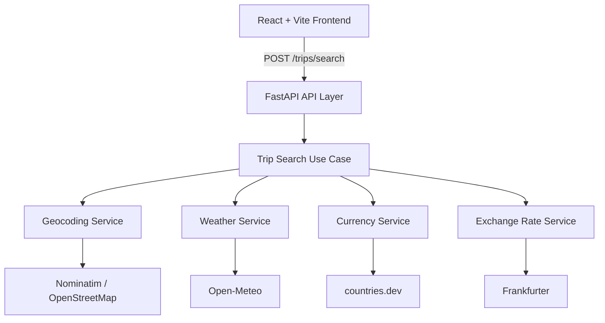

# 🌍 Smart Trip Planner

Smart Trip Planner is a full-stack web application built with **React** and **FastAPI** that brings useful travel information together in a simple, responsive interface.

Enter an origin, a destination, and travel dates to explore the destination's weather forecast, daily weather conditions, currencies, and exchange rates. The project emphasizes modular architecture, external API integrations, validation, testing, and maintainable code.

> **Project status:** The trip-search experience is implemented. Points of interest and itinerary generation are planned for future versions, not available in the current release.

## ✨ Features

### For travelers

- Search for a trip using an origin, destination, departure date, and arrival date.
- View a daily destination weather forecast, including maximum and minimum temperatures and precipitation.
- See weather-condition icons based on Open-Meteo's WMO weather codes.
- Identify the origin and destination currencies and view their exchange rate.
- Use a responsive interface on desktop and mobile.
- Receive feedback during loading and clear messages when a request fails or form information is invalid.

### Engineering features

- React frontend powered by Vite.
- FastAPI backend organized as a modular monolith.
- Asynchronous integrations with external services using `httpx`.
- Typed data contracts and request validation using Pydantic v2.
- Dependency injection, centralized error handling, and logging.
- Environment-based configuration.
- Backend unit and API tests with mocked external services.
- Ruff linting/formatting and a GitHub Actions backend CI pipeline.

## 🛠️ Tech Stack

| Area | Technologies |
| --- | --- |
| Frontend | React, JavaScript, Vite, React DatePicker, React Icons, Moment.js, CSS |
| Backend | Python 3.12, FastAPI, Pydantic v2, pydantic-settings, httpx |
| Testing & quality | pytest, pytest-cov, Ruff, frontend lint/build scripts |
| CI | GitHub Actions |

## 🏗️ Architecture

The frontend communicates with the FastAPI backend, which coordinates dedicated external-service adapters. The browser does **not** call the third-party travel APIs directly.



### Backend layers

- **API layer:** HTTP endpoints, request/response handling, and exception handlers.
- **Application layer:** use cases and orchestration of services.
- **Domain layer:** typed Pydantic models and validation rules.
- **External services:** adapters for geocoding, weather, currencies, and exchange rates.
- **Configuration:** centralized settings using `pydantic-settings`.

The separation between layers makes third-party integrations easier to test and change without coupling them to the user interface.

## 🌐 External APIs

| Provider | Purpose |
| --- | --- |
| [Nominatim / OpenStreetMap](https://nominatim.org/) | Resolve origin and destination to geographic coordinates and country information |
| [Open-Meteo](https://open-meteo.com/) | Daily destination weather forecasts and WMO weather codes |
| [countries.dev](https://countries.dev/) | Currency information for each country |
| [Frankfurter](https://www.frankfurter.dev/) | Currency exchange rates |

Weather forecasts are limited to the date range supported by the weather provider. Future travel dates outside that range may not have forecast data.

## 🚀 Getting Started

### Prerequisites

- **Python 3.12**
- **Node.js and npm** compatible with the project's Vite version
- Git

You will need **two terminals**: one for the backend and another for the frontend.

### 1. Clone the repository

```bash
git clone https://github.com/PedroCorreia23/smart-trip-planner.git
cd smart-trip-planner
```

### 2. Set up the backend

From the repository root:

```bash
cd backend
python -m venv .venv
```

Activate the virtual environment:

**Windows PowerShell**

```powershell
.\.venv\Scripts\Activate.ps1
```

**Linux / macOS**

```bash
source .venv/bin/activate
```

Install dependencies:

```bash
pip install -r requirements.txt
```

Create your local environment configuration from the provided example:

**Windows PowerShell**

```powershell
Copy-Item .env.example .env
```

**Linux / macOS**

```bash
cp .env.example .env
```

Review `backend/.env` if you need to adjust service URLs or HTTP settings. The example file defines the expected configuration structure.

Start the API:

```bash
fastapi dev app/main.py
```

By default, the API is available at **http://127.0.0.1:8000** and its interactive documentation at **http://127.0.0.1:8000/docs**.

### 3. Set up the frontend

Open a **second terminal** at the repository root:

```bash
cd frontend
npm install
```

Create the frontend environment file:

**Windows PowerShell**

```powershell
Copy-Item .env.example .env
```

**Linux / macOS**

```bash
cp .env.example .env
```

Ensure `frontend/.env` contains the address of your running backend:

```dotenv
VITE_API_BASE_URL=http://127.0.0.1:8000
```

Start the development server:

```bash
npm run dev
```

Open the URL printed in the terminal (typically **http://localhost:5173**).

> Variables prefixed with `VITE_` are included in client-side code. **Do not put API secrets, passwords, or private tokens in frontend environment variables.**

### 4. Try a trip search

With both servers running, enter two cities and dates within the weather forecast's supported range. Select **Search Trip** to see the results.

## 🔎 API

### Health check

```http
GET /health
```

Expected response:

```json
{
  "status": "ok"
}
```

### Trip search

```http
POST /trips/search
Content-Type: application/json
```

Example request (replace dates with dates supported by the forecast provider):

```json
{
  "origin": "Lisbon",
  "destination": "Paris",
  "start_date": "YYYY-MM-DD",
  "end_date": "YYYY-MM-DD"
}
```

The response includes trip details, origin and destination coordinates, daily destination weather, origin and destination currency information, and the exchange rate.

The daily weather data includes these arrays, indexed by date:

```json
{
  "time": ["2026-10-14"],
  "temperature_2m_max": [21.4],
  "temperature_2m_min": [11.2],
  "precipitation_sum": [0.0],
  "weather_code": [0]
}
```

*The weather values above are illustrative, not a live forecast.*

When both locations use the same currency, the exchange rate is `1.0`.

For full request/response schemas, visit `/docs` while the backend is running.

## 🧪 Testing and Code Quality

### Backend

From `backend/` with the virtual environment activated:

```bash
python -m pytest
```

Run tests with coverage:

```bash
python -m pytest --cov=app --cov-report=term-missing
```

Run Ruff:

```bash
ruff check .
ruff format --check .
```

The backend suite currently contains **27 automated tests**, covering geocoding, weather, currencies, exchange rates, orchestration, validation, and FastAPI endpoints. Tests mock third-party services so they do not require live API requests.

### Frontend

From `frontend/`:

```bash
npm run lint
npm run build
```

The interface has also been manually checked for form validation, loading/errors, keyboard submission, trip results, and responsive layouts.

### Continuous Integration

GitHub Actions runs backend checks on pushes and pull requests to `main`, including Ruff and pytest. Frontend commands can be executed locally as shown above; do not assume they are part of CI unless the workflow is updated to include them.

## ⚠️ Error Handling and Validation

- Trip inputs are validated by Pydantic on the backend.
- The frontend validates required fields and date order before sending a request.
- Unknown locations return an HTTP `404` response.
- Unavailable external services can return an HTTP `502` response.
- User-facing loading and error states are displayed in the frontend.
- Service failures and relevant application events are logged without intentionally logging sensitive settings.

## 📁 Project Organization

```text
smart-trip-planner/
├── backend/
│   ├── app/
│   │   ├── application/       # Trip-search orchestration
│   │   ├── domain/            # Pydantic models / contracts
│   │   ├── services/          # Third-party API adapters
│   │   ├── config.py          # Application settings
│   │   └── main.py            # FastAPI application
│   ├── tests/                 # Backend automated tests
│   ├── .env.example
│   └── requirements.txt
├── frontend/
│   ├── src/
│   │   ├── components/        # Form, results, weather icons
│   │   └── utils/             # Weather-code mapping
│   ├── .env.example
│   └── package.json
└── README.md
```

*This tree highlights the main parts of the project rather than every file.*

## 🗺️ Roadmap

### Implemented

- Trip definition and validation
- Geocoding for origin and destination
- Daily destination weather forecasts and condition icons
- Currency information and exchange rate retrieval
- Responsive React frontend
- Backend tests and CI checks

### Planned

- **Points of interest:** discover and select attractions in a destination.
- **Itinerary generation:** build itineraries from selected places.
- **Route optimization:** arrange stops efficiently, potentially considering travel times.
- **Additional trip context:** opening hours, visit durations, and user preferences.
- **Persistence:** saved trips and possible PostgreSQL integration.

Direct origin-to-destination distance calculation was deferred because it adds limited value to the current trip-search workflow; distance may be more useful for future route planning.

## 📄 Repository

[Smart Trip Planner on GitHub](https://github.com/PedroCorreia23/smart-trip-planner)
